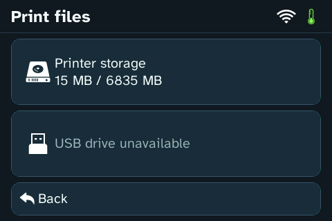
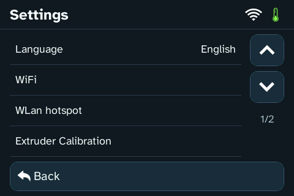

<h1 align="center">Flashforge Finder</h1>
<h3 align="center">Revival Project</h3>

  

This project has no official Discord or subreddit. Please use
[GitHub Issues](https://github.com/pdromnt/finder-revival/issues) for discussion
and reports.

Local-first custom firmware extensions for the **Linux-based Flashforge Finder
Plus / V2**, built around the printer's existing control software.

Modern touchscreen, printer-hosted dashboard, Orca G-code → GX conversion,
file listing/deletion, USB camera, owner-controlled SSH, a custom boot splash,
and bounded RAM diagnostics instead of constant vendor log writes.

## What changes

| Feature | What Revival adds |
| --- | --- |
| Touchscreen | New home layout, themed subscreens, rounded dialogs and clearer maintenance text |
| Local dashboard | Status, file browsing, thumbnails, uploads, deletion and print prompts, served by the printer |
| Orca integration | Direct uploads with printer-side G-code → GX conversion and supported thumbnail/metadata handling |
| USB camera | Automatic detection of compatible UVC/MJPEG cameras, dashboard video and snapshots |
| SSH | Password login for first setup, optional owner keys and a unique per-printer host identity |
| Logging | Routine vendor spam suppressed; useful diagnostics kept in capped RAM |
| Local operation | Legacy cloud/update controls retired in favor of the local dashboard |

More touchscreen screenshots

**Experimental. One printer tested. No warranty. An incorrect install can leave
the printer unbootable.** This is an overlay for a verified stock installation,
not a replacement motion-control firmware or an 8 GB image to clone onto yours.

[Install](#installation) · [Back up](#backups-and-storage-health) ·
[Recover](#rollback-and-recovery) · [Use the dashboard](#dashboard-orca-and-camera) ·
[All guides](docs/README.md)

## Compatibility and requirements

**Required stock firmware: 2.8.4.366 F2.12, build 20210823 (23 August 2021).**
Before installing, confirm that exact version in the printer's About page and
verify the executable hash in [compatibility](docs/compatibility.md). An older
or different build is unsupported; a matching model name or “latest” label is
insufficient. The installer refuses a different stock executable.

**Required USB drive: 16 GB minimum, formatted as FAT32.** FAT32 is mandatory
for the supported install, backup and recovery workflow; exFAT and NTFS are
not supported. Keep room for your own printer's backup and rollback reports.
Allow at least **8 GiB free** for one full acquisition, plus reports and snapshots.

The firmware target is the **Linux/eMMC Finder Plus / V2**, with development PCB
Finder Plus V2.0.2 and About board 2.X. Original non-Linux Finder, Finder Lite,
Finder 3, Adventurer and Guider firmware are outside this profile. The PC-side
Orca presets below support classic Finder 1 / 2 / Plus independently.

## Installation

Routine installation, backup and rollback use the stock USB startup hook.
**UART, soldering and a pre-existing SSH connection are not normal prerequisites.**
The [USB quickstart](docs/quickstart.md) walks through the first setup.

1. [Check hardware/firmware compatibility](docs/compatibility.md).
2. [Read validation limits](docs/validation.md) and [back up your printer](docs/backup.md).
3. [Understand storage corruption and repair](docs/storage-repair.md).
4. Follow [installation](docs/installation.md) and the experimental
   [USB-only workflow](docs/usb-maintenance.md), keeping [UART recovery](docs/recovery.md)
   and the [restore runbook](docs/restore.md) available.
5. Use `http://PRINTER_IP:8081/` and [dashboard/Orca setup](docs/usage.md).

The [USB guide](docs/usb-maintenance.md) walks through **CHECK → BACKUP → INSTALL**.
The generic ZIP contains an example request, not an armed operation. Each explicit
request is consumed once; on-screen stages end with instructions to remove USB
and power-cycle. Keep power and USB connected until that final screen.

Preserve the complete installation report and rollback archive on the PC.
After installation, the printer boots and runs without the stick or a PC bridge.
For a source build, use [development](docs/development.md); for an assistant-led
setup, use [assistant-guided installation](docs/agent-installation.md).

INSTALL includes the boot splash, touchscreen, SSH and dashboard in one operation.
The splash converter uses your own hash-verified kernel, with temporary files and
both original kernel copies saved on USB. No vendor kernel is distributed.
See [kernel recovery](docs/recovery.md) before installation.

USB-only CHECK, packaged upgrade/reinstallation and rollback, each followed by
a normal power cycle, passed on the development Finder.
See the [validation record](docs/validation.md) for the measured results.

## Dashboard, Orca and camera

Open **`http://PRINTER_IP:8081/`** in a browser or Orca's Device tab. The printer
hosts both the dashboard and conversion endpoints.

For first-time SSH setup, connect as **`root`** on port **2222**, password
**`flashforge_revival`**. Change it with `passwd` after login. Existing SSH
configuration/passwords are preserved on upgrades. Supplying your public key
as `revival/authorized_keys` selects key-only setup instead of initializing a password.

* Configure an **OctoPrint-compatible** physical printer in Orca using that URL
  and the printer's own key from **Slicer setup**.
* Upload `.gcode` directly. The printer converts it to `.gx` for native previews,
  then discards the source upload. No leftover `.gcode` copy is kept in the file list.
* Browse existing files, inspect previews and delete files through the dashboard.
  Uploads offer **Print now / Keep for later**; uploading alone does not start a job.
* Connect a compatible USB camera for video and snapshots. One dashboard video
  stream at a time is supported; snapshots remain available.

[OrcaSlicer presets and bed assets](slicer/orca/README.md) are included for
**Finder 1 / 2 / Plus**. Enable the Guider 2s system preset before import. The
optional PLA preset targets **AllMetal-modified hotends**. These PC-side slicer
files have broader targets than the separately guarded firmware overlay.
Keep the bed texture and model in a stable PC folder so Orca retains their paths.

[Usage and camera details](docs/usage.md) · [Troubleshooting](docs/troubleshooting.md)

## Backups and storage health

Keep two things outside the printer:

* **Your original backup**, including storage images, identity/calibration,
  original kernel and startup configuration. Independently verify hashes and
  lengths after copying to the PC.
* **Each installation report**, including its private managed-file rollback
  archive and both original kernel images. This restores that installation's previous files and complements
  the original backup.

USB carries the bulk data during backup and recovery. UART supplies console
control when needed; you do not send an 8 GB image through the serial cable.
Normal recovery restores only the files needed for the failure.

The development printer already had ext4 metadata corruption in its original
dump, including malformed log-directory entries. Revival suppresses routine
vendor log spam and caps RAM logging at **256 KiB**, but that does not repair
existing damage. Installation stops when offline checks fail.

Follow [storage diagnosis and repair](docs/storage-repair.md): preserve the
current state, rehearse repairs on copies, and repair only **unmounted**
filesystems. A read-only mount is still mounted. Do not blindly delete broken logs.

Backups and reports may contain credentials and device identity. Keep verified
PC copies private. [Backup procedure and PC verification](docs/backup.md)

## Rollback and recovery

Choose the smallest recovery that matches the failure:

| Situation | Recovery route |
| --- | --- |
| Theme problem; Linux/SSH works | [Theme-only fallback](docs/restore.md#theme-only-fallback), retaining logging and network guards |
| Undo a packaged installation | [USB managed-file rollback](docs/usb-maintenance.md#rollback) using the saved report from this printer |
| Overlay/startup failure | [Restore runbook](docs/restore.md), including offline stock-UI rescue |
| Black screen after a kernel/splash change | [UART/U-Boot recovery](docs/recovery.md): RAM-boot your original kernel, then restore both internal kernel copies |
| Corrupt directory entries or ext4 errors | [Offline storage repair](docs/storage-repair.md), with current-state preservation and repair rehearsal |

USB-only maintenance needs readable internal startup files. If Linux cannot
reach the hook, use the recovery console. The verified interface is **3.3 V TTL**
(or a Pico debugprobe), with **VCC disconnected**. The
[UART guide](docs/recovery.md) covers wiring and bootloader commands.

Rollback preserves owner keys and keeps cloud switches OFF. If it returns to
stock startup, keep Internet access blocked at the router because stock logging
and update behavior can return. A full backup is valuable, but there is no generic
whole-eMMC rewrite procedure or guaranteed recovery from hardware failure.

**“Installation incomplete / Do not reboot yet” means stop and inspect the report
while keeping power and USB connected.** Follow the restore guide instead of
repeatedly power-cycling a partial installation.

[Factory Reset](docs/factory-reset.md) is a settings reset, not an uninstall or
recovery method. Revival, owner access and calibration survived the tested reset
and power cycle. The stock action still changes display name, registration,
language and hotspot name.

## Your printer stays yours

Releases contain Revival-owned source, programs/assets and install scripts.
They do **not** contain cloned partitions, stock firmware binaries, serials,
registration codes, calibration, Wi-Fi/cloud credentials, SSH private keys,
dashboard keys or another printer's print files.

Identity and calibration are preserved in place. Keys are generated per
installation; SSH accepts the owner's public key. See [identity](docs/identity.md).

## Deliberately local

Legacy Flashforge Cloud, Polar Cloud and vendor update controls are deprecated
in favor of the local dashboard. Installation disables the two cloud switches
while preserving account/registration data and external rollback copies.
Local TCP printing is independent of those switches on the supported firmware.

Hidden menus are not a security boundary. Read the outbound policy and its
limits in [local-only operation](docs/security.md). Do not expose the printer's
HTTP, camera, SSH or stock control ports to the Internet.

## Project layout

| Path | Purpose |
| --- | --- |
| `ui-prototype/` | Production Qt 4 adapter/theme; historical folder name |
| `web-service/` | ARM C backend, static dashboard and integration fixtures |
| `logging/` | RAM logger and hard memory cap |
| `network/` | Local-only network policy |
| `installer/` | Generic USB/bootstrap and overlay packaging |
| `profiles/` | Exact supported firmware hashes/layout facts |
| `slicer/orca/` | Classic Finder Orca presets, bed texture/model and credits |
| `tools/` | Portable public build, packaging and audit tools |
| `docs/` | User, recovery, development and reverse-engineering guides |

Private research, complete dumps, access keys and generated images remain
outside Git through a default-deny `.gitignore`.
[Documentation index](docs/README.md) · [Build/release guide](docs/development.md) ·
[Third-party notices](THIRD_PARTY.md)

Binary releases include a separate [runtime source/relink companion](licenses/runtime/README.md).
Download/publish it alongside the small USB package; it stays on the PC.

Original code uses the [Unlicense](LICENSE). Third-party components retain their
licenses. Flashforge names/logos identify the original hardware; this project
is independent of Flashforge.
