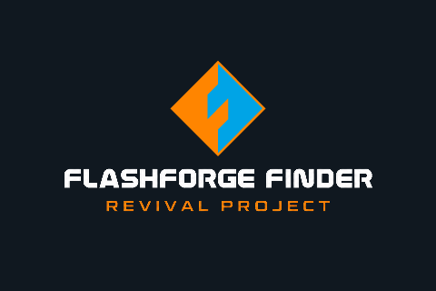
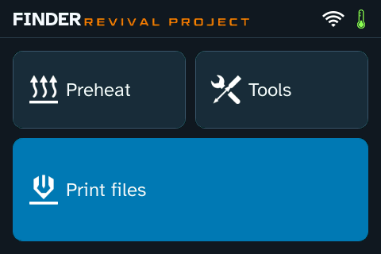

<h1 align="center">Flashforge Finder</h1>
<h3 align="center">Revival Project</h3>

  

This project has no official Discord or subreddit. Please use
[GitHub Issues](https://github.com/pdromnt/finder-revival/issues) for discussion
and reports.

Local-first custom firmware extensions for the **Linux-based Flashforge Finder
Plus / V2**, built around the printer's existing control software.

Modern touchscreen, printer-hosted dashboard, Orca G-code → GX conversion,
file listing/deletion, USB camera, owner-controlled SSH, a custom boot splash,
and bounded RAM diagnostics instead of constant vendor log writes.

**Experimental. One printer tested. No warranty. An incorrect install can leave
the printer unbootable.** This is an overlay for a verified stock installation,
not a replacement motion-control firmware or an 8 GB image to clone onto yours.

## Start here

**Required stock firmware: 2.8.4.366 F2.12, build 20210823 (23 August 2021).**
Before installing, confirm that exact version in the printer's About page and
verify the executable hash in [compatibility](docs/compatibility.md). An older
or different build is unsupported; a matching model name or “latest” label is
insufficient. The installer refuses a different stock executable.

**Required USB drive: 16 GB minimum, formatted as FAT32.** FAT32 is mandatory
for the supported install, backup and recovery workflow; exFAT and NTFS are
not supported. Keep room for your own printer's backup and rollback reports.

1. [Check hardware/firmware compatibility](docs/compatibility.md).
2. [Read validation limits](docs/validation.md) and [back up your printer](docs/backup.md).
3. [Understand storage corruption and repair](docs/storage-repair.md).
4. Follow [installation](docs/installation.md) and the experimental
   [USB-only workflow](docs/usb-maintenance.md), keeping [UART recovery](docs/recovery.md)
   and the [restore runbook](docs/restore.md) available.
5. Use `http://PRINTER_IP:8081/` and [dashboard/Orca setup](docs/usage.md).

[Factory Reset](docs/factory-reset.md) and a subsequent power cycle passed on
the development printer: Revival, owner access and calibration survived. The
stock reset still changes the display name, registration, language and hotspot name.

[OrcaSlicer presets and bed assets](slicer/orca/README.md) are included for
**Finder 1 / 2 / Plus**. Enable the Guider 2s system preset before import. The
optional PLA preset targets **AllMetal-modified hotends**. These PC-side slicer
files have broader targets than the separately guarded firmware overlay.

USB-only CHECK, packaged upgrade/reinstallation and rollback, each followed by
a normal power cycle, passed on the development Finder.
The community installer remains experimental; see [validation](docs/validation.md).

## Your printer stays yours

Releases contain Revival-owned source, programs/assets and install scripts.
They do **not** contain cloned partitions, stock firmware binaries, serials,
registration codes, calibration, Wi-Fi/cloud credentials, SSH private keys,
dashboard keys or another printer's print files.

Identity and calibration are preserved in place. Keys are generated per
installation; SSH accepts the owner's public key. See [identity](docs/identity.md).

## Deliberately local

Legacy Flashforge Cloud, Polar Cloud and vendor update controls are deprecated
in favor of the local dashboard. Installation disables the two cloud switches
while preserving account/registration data and external rollback copies.
Local TCP printing is independent of those switches on the supported firmware.

Hidden menus are not a security boundary. Read the outbound policy and its
limits in [local-only operation](docs/security.md). Do not expose the printer's
HTTP, camera, SSH or stock control ports to the Internet.

## Project layout

| Path | Purpose |
| --- | --- |
| `ui-prototype/` | Production Qt 4 adapter/theme; historical folder name |
| `web-service/` | ARM C backend, static dashboard and integration fixtures |
| `logging/` | RAM logger and hard memory cap |
| `network/` | Local-only network policy |
| `installer/` | Generic USB/bootstrap and overlay packaging |
| `profiles/` | Exact supported firmware hashes/layout facts |
| `slicer/orca/` | Classic Finder Orca presets, bed texture/model and credits |
| `tools/` | Portable public build, packaging and audit tools |
| `docs/` | User, recovery, development and reverse-engineering guides |

Private research, complete dumps, access keys and generated images remain
outside Git through a default-deny `.gitignore`.
[Documentation index](docs/README.md) · [Build/release guide](docs/development.md) ·
[Third-party notices](THIRD_PARTY.md)

Binary releases include a separate [runtime source/relink companion](licenses/runtime/README.md).
Download/publish it alongside the small USB package; it stays on the PC.

Original code uses the [Unlicense](LICENSE). Third-party components retain their
licenses. Flashforge names/logos identify the original hardware; this project
is independent of Flashforge.
