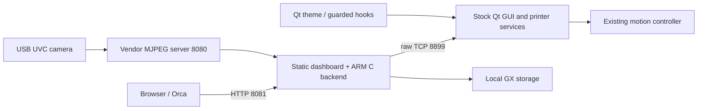

# Architecture

## Components

* `revival_ui.c` and `flow_skin.c` use Qt 4.8.6/QWS ABI and pinned symbols to
  restyle the original widgets. The vendor ELF stays intact. Hooks check known
  prologues and restrict behavior to the expected executable/objects.
* `native_capacity.c` replaces specific synchronous shell capacity queries
  with read-only native equivalents, with bounded traversal and stock fallback.
* The launcher verifies stock/asset hashes, disables cores, and falls back to
  stock presentation on guarded startup failure. It is not a hang watchdog.
* `revival_log.c` replaces only the known logger registration/file open; it
  preserves useful diagnostics in capped RAM rather than rotating on eMMC.
* `web-service/native` implements HTTP, GX conversion, bounded image decoding,
  file identity checks and serialized stock commands in C. The browser runs JS;
  the printer does not run a JS engine.
* Cloud/update UI suppression, updater disabling and outbound routing are
  separate layers. See [security](security.md) for what each actually guarantees.

## Paths and resources

| Path | Purpose |
| --- | --- |
| `/PROGRAM/revival-ui` | Theme adapter, rules, fonts and wordmark |
| `/PROGRAM/revival-web` | Backend, static assets and checksums |
| `/PROGRAM/revival-logging` | Logging adapter |
| `/PROGRAM/revival-network` | Local-only policy and guarded runtime code |
| `/etc/revival` | Owner-controlled SSH configuration/keys |
| `/etc/revival-web/key` | Per-printer dashboard key |
| `/run/revival-*` | Volatile runtime state |
| `/run/revival-logs` | Dedicated 256 KiB tmpfs; two 64 KiB UI log files |
| `/data/.revival-web` | Private conversion/output staging |
| `/data` | Original printer storage; not replaced by a release |

Uploads use disk-backed anonymous temporary source files, not full-file RAM
buffers. GX publication uses validated temporary output and atomic rename.
At least twice the request size plus 16 MiB must be free. Cancellation cannot
undo a request that completed before the cancellation arrived.

The command listener handles one accepted client at a time and has a roughly
10-second idle timeout. Holding it indefinitely for a dashboard could starve
uploads/control. A genuine state-push bridge would need new internal IPC;
it has not been implemented.

Native Qt strings are nontrivial C++ return values, so hidden return arguments,
QFlags copy behavior, object lifetime and old glibc ABI matter. Do not treat the
adapter as portable to another binary by changing one address.
